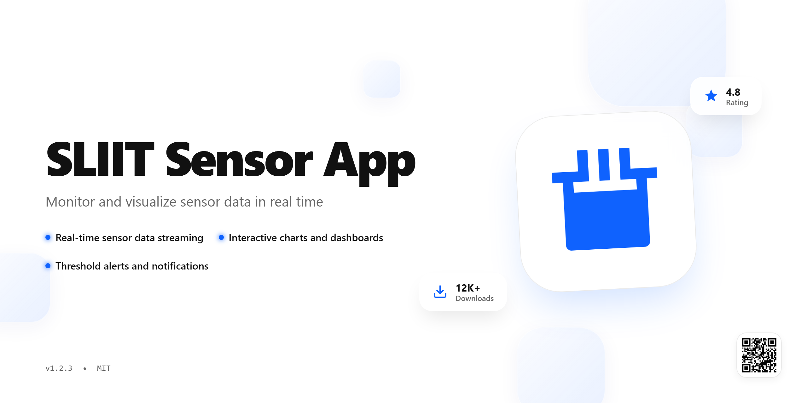

# SLIIT Sensor App — Smart Sensing Web Platform

### ⌨️ PowerShell Command Button

  

---

SLIIT Sensor App unifies a React web client, a Java desktop built with Window, and a API powered by,, and Mongoose into one cohesive sensor monitoring platform. Real-time email and SMS notifications keep informed the moment readings shift, while MongoDB stores every event for dependable historical analysis. A Java RMI server and lightweight sensor simulators complete the stack, giving developers an open and accessible environment to explore, extend, and refine.

## 📋 System Requirements

- Windows 10 or Windows 11
- PowerShell 5.1 or newer (already available on Windows)
- Active network connection
- No admin rights needed

## Features

* **Unified Sensor Dashboard:** Monitor every connected sensor from a single, intuitive web client — live readings, status indicators, and historical trends presented in a clean, responsive interface.
* **Cross-Platform Desktop Companion:** A purpose-built Java desktop delivers the same sensor visibility on Windows, giving operators a dependable native experience alongside the browser-based client.
* **Robust API Layer:** A well-structured API powers every client consistently, making sensor data and management operations simple to integrate and extend.
* **Automated Alerts & Notifications:** Configurable email and SMS notifications keep the right people informed the moment a sensor crosses a threshold — no constant screen-watching required.
* **Reliable Data Persistence:** A document-oriented database stores readings and configuration securely, so history is always available for review and analysis.
* **Distributed Sensor Simulation:** Built-in simulators let you exercise the full system end-to-end, validating behavior without requiring physical hardware on day one.
* **Real-Time Data Streaming:** Lightweight asynchronous updates push fresh readings to the interface as they arrive, keeping the dashboard current without manual refreshes.
* **Streamlined Record Management:** Intuitive create, read, update, and delete workflows make managing sensors, users, and settings straightforward for administrators.
* **Accessible to Every:** An openly available codebase welcomes students, researchers, and to explore, learn from, and build upon the platform.

## Tech Stack

SLIIT Sensor App brings together a carefully chosen stack that balances real-time responsiveness, desktop-grade reliability, and developer velocity. Every layer was selected to keep the experience fast, consistent, and effortless across web and desktop.

**Frontend & Client Experience**

- **** powers the web client, delivering a smooth, component-driven interface that keeps sensor data vivid and interactive.
- **jQuery, JavaScript & AJAX** drive the sensor simulators, enabling live updates and seamless asynchronous exchanges without page reloads.

**Desktop **

- **Java ** anchors the desktop experience with a dependable, native-feeling interface.
- **Windows **, the bidirectional Java, streamlines the construction of polished desktop layouts and keeps the visual layer in sync with the code.

**Backend & Services**

- ** with ** form the API backbone, handling requests with speed and clarity.
- **Mongoose** models the data layer with an elegant, schema-driven approach.
- **Email & SMS services** are woven into the API to keep users promptly informed.
- **Java RMI Server** provides robust remote communication between distributed components.

**Data & Persistence**

- **MongoDB**, the NoSQL database, stores sensor readings and data with the flexibility that modern sensor workloads demand.

Together, these technologies form a cohesive, thoughtfully integrated foundation — one that lets the SLIIT Sensor App feel refined on the surface and dependable underneath.

## FAQ

**Is SLIIT Sensor App suitable for evaluation and academic projects?**
Absolutely. The is designed as a complete, self-contained sensor monitoring platform, making it a strong fit for coursework, demonstrations, and portfolio showcases. Every layer — web client, desktop console, API, and sensor simulators — is included so you can explore the full architecture end to end.

**What makes SLIIT Sensor App different from a typical sensor dashboard?**
It brings together a web client, a Java desktop built with Window, a API powered by and, a Java RMI server, and live sensor simulators driven by JQuery, JavaScript, and AJAX — all working in concert. You get a genuinely full-stack experience rather than an isolated front end.

**Do I need to purchase anything to get started?**
No purchase is required. SLIIT Sensor App is openly accessible to everyone, with the complete source available for you to study, adapt, and extend. It is built to lower the barrier for learning and experimentation.

**Can I customize the app for my own use case?**
Yes. The modular structure — separate web, desktop, API, and RMI components — means you can replace, extend, or enhance individual modules without disrupting the. Whether you want to add new sensor types, adjust alert thresholds, or connect additional notification channels, the architecture is ready for your modifications.

**How are alerts and notifications delivered?**
The platform integrates email and SMS services through its API layer, so sensor events trigger timely notifications to the people who need them. MongoDB stores readings and event history, giving you a dependable record for review and analysis.

**Is my data handled responsibly?**
The app uses MongoDB as its NoSQL database and communicates through a structured API, keeping data flow organized and predictable. Each component operates within clear boundaries, which helps you reason about security and privacy as you deploy.

**What kind of support and updates can I expect?**
SLIIT Sensor App is actively maintained, with refinements guided by real usage and feedback. Documentation covers the features and tech stack in detail, and the project welcomes contributions that improve stability, usability, and reach.

**Where can I learn more about the project?**
Start with the Features and Tech Stack sections of this README for a complete overview, then explore the desktop and web clients firsthand. The project is built to be explored — dive in and see how each layer connects.

## License

SLIIT Sensor App is offered under a permissive, open distribution model designed to make adoption effortless for and individuals alike. You are welcome to explore the codebase, adapt it to your own sensor workflows, and build upon it without licensing overhead.

**What you can do**

- **Use it anywhere** — personal projects, academic work, or commercial deployments.
- **Modify and extend** — tailor the web client, desktop, API, and simulator components to your needs.
- **Share your improvements** — redistribute your adapted version, provided the original attribution is preserved.

**What we ask**

- Retain the original copyright notice and this license body in any redistribution.
- Provide clear attribution to the SLIIT Sensor App project in derivative works.
- Understand that the software is provided "as is," without warranty of any kind, express or implied. The maintainers are not liable for any damages arising from its use.

**Contributions**

By submitting improvements back to the project, you agree that your contributions may be distributed under the same terms. We appreciate every enhancement, fix, and suggestion that helps the SLIIT Sensor App grow stronger for everyone.

For the complete legal text, refer to the LICENSE file included with the project distribution.